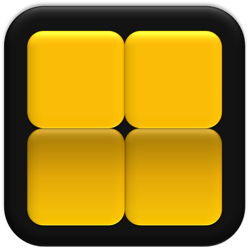

<p align="center">
  
</p>

<h1 align="center">StartEmAll</h1>

<p align="center">
  <b>A quick launcher for your apps and games, with 3D tilting cards and a side strip you can pull out at any screen edge.</b><br>
  Drop in a shortcut, click a card, play. Native Windows app, offline, open source.
</p>

<p align="center">
  
  
  
  
</p>

<p align="center">
  <a href="https://github.com/iam-aydin/StartEmAll/releases/latest"><b>Download the latest release</b></a> ·
  <a href="#features">Features</a> ·
  <a href="#get-started">Get started</a> ·
  <a href="#the-side-strip">Side strip</a> ·
  <a href="#build-from-source">Build</a>
</p>

<br>

<p align="center">
  
  <br>
  <sub>The main window. Cards tilt toward your cursor and catch a soft light as you move over them.</sub>
</p>

<br>

<table>
  <tr>
    <td width="25%" valign="top">
      <h3>🃏 Cards with depth</h3>
      Every shortcut is a real 3D card that tilts toward the cursor, with a perspective camera and a moving spotlight.
    </td>
    <td width="25%" valign="top">
      <h3>↔️ Side strip</h3>
      Hold Ctrl with the cursor at a screen edge and a quick-launch strip slides in. Works on every monitor.
    </td>
    <td width="25%" valign="top">
      <h3>🖱️ Drag and drop</h3>
      Drop a <code>.lnk</code> or <code>.exe</code> on the window to add it. Shortcuts are followed to the real exe for a sharp icon.
    </td>
    <td width="25%" valign="top">
      <h3>🪟 Looks native</h3>
      Dark and light themes, Solid or Mica Alt backdrop, rounded corners, and a tray icon so it stays out of the way.
    </td>
  </tr>
</table>

<br>

## Features

### Add shortcuts the easy way
- **Drag and drop** `.lnk`, `.exe` or any file onto the main window.
- Or use the **+ card** to pick one or many files (`.exe`, `.lnk`, `.bat`, `.cmd`, `.url`, or anything else).
- Adding a `.lnk` follows it to the **real exe** and keeps its name and arguments, so you get the program's full-size icon (up to 256 px) instead of the tiny shell icon. If the shortcut has its own custom icon, that one is kept.
- Paths can use `%ENV%` variables and `*` / `?` wildcards, and several candidates can be separated with `|`, so a shortcut survives version folders that change name.
- If a target goes missing, clicking the card asks you to locate it again.

### Make them yours
Right-click a card:

| Action | What it does |
|---|---|
| **Show in side strip** | Adds or removes the card from the strip |
| **Rename…** | Changes the label on the card |
| **Change icon…** | Pick an image (`ico`, `png`, `jpg`, `bmp`, `gif`, `tif`) or take the icon from an `.exe`, `.dll` or `.lnk` |
| **Reset icon** | Back to the program's own icon |
| **Remove shortcut** | Deletes the card |

Hold and drag a card to **reorder** it, in the main window and in the strip. Sort by **Personalized**, **Name A → Z / Z → A**, or **Newest / Oldest first** from the pill at the top.

### The side strip
- Hold the trigger key (**Ctrl** by default, or Shift, or none) with the cursor resting at your chosen screen edge: **Right**, **Left**, **Top** or **Bottom**.
- It opens on whichever monitor the cursor is on, and hides again when you move away.
- Hovering a strip icon shows a small box with the shortcut's name.
- The cursor is polled on its own thread, so heavy card animation can never make the strip feel laggy.
- Dwell time, edge and trigger key are all adjustable in Settings.

### Settings
- **Appearance:** dark or light theme, Solid or Mica Alt backdrop (needs Windows 11 22H2+), window opacity, scroll bars on or off.
- **Side strip:** on/off, screen edge, trigger key, dwell time.
- **General:** close button hides to tray or quits, hide the launcher after starting something, start with Windows, open the settings folder, reset everything.

<br>

## Get started

1. Download **`StartEmAll-Setup.exe`** from the [latest release](https://github.com/iam-aydin/StartEmAll/releases/latest) and run it. It installs per user, so there is **no admin prompt**.
2. Drag a shortcut or exe onto the window, or click the **+** card.
3. Click a card to launch it. Hold **Ctrl** at the right edge of your screen to try the side strip.

Prefer no installer? The release also has a plain **`StartEmAll.exe`** that runs anywhere with nothing to install.

Closing the window hides StartEmAll to the tray by default. Double-click the tray icon to bring it back, or right-click it for **Open**, **Settings** and **Quit**.

### Your data
`settings.json` and the `icons` folder live next to the exe. If that folder is read-only (for example in Program Files), they go to `%APPDATA%\StartEmAll` instead. The installer keeps your settings when you update or uninstall.

<br>

## Build from source

You need the [.NET 8 SDK](https://dotnet.microsoft.com/download/dotnet/8.0).

```cmd
run.cmd                  :: run from source, no exe
build.cmd                :: small single-file exe (needs the .NET 8 Desktop Runtime)
build-standalone.cmd     :: ~150 MB exe that runs anywhere
build-installer.cmd 1.0.0 :: standalone exe wrapped in installer\Output\StartEmAll-Setup.exe
```

The installer needs [Inno Setup 6](https://jrsoftware.org/isinfo.php): `winget install JRSoftware.InnoSetup`.

### Publish a release
```sh
git tag v1.0.0 && git push origin v1.0.0
```
The GitHub Actions workflow in `.github/workflows/release.yml` builds the installer and attaches `StartEmAll-Setup.exe` and `StartEmAll.exe` to a new Release.

### Project layout
```
StartEmAll.csproj
App.xaml / App.xaml.cs       startup, single instance
src/
  Core.cs                    windows, tray icon, rebuild / commit
  Config.cs                  settings.json
  Theme.cs                   palette, Solid / Mica Alt backdrop, brushes
  Native.cs                  DWM / user32 interop
  AppLauncher.cs             path resolve, .lnk reading, icon extraction, launch
  IconStore.cs               custom icons, resized and kept in the icons folder
  Tile.cs                    the 3D card and strip tooltip
  Renderer.cs                smooth scroll + card animation loop
  StripController.cs         edge strip (cursor polled on its own thread)
  Reorder.cs                 hold and drag to reorder
  PromptBox.cs               small themed text dialog (Rename)
  SettingsPages.cs           settings pages
ui/
  Styles.xaml                control styles
  MainWindow / StripWindow / SettingsWindow
installer/                   Inno Setup script and wizard images
```

<br>

## Known limits
- Windows only (WPF).
- Drag and drop onto the window won't work if StartEmAll runs as administrator but Explorer doesn't.
- Store (UWP) shortcuts have no real exe target, so they stay as the `.lnk` and may show a smaller icon.
- Adding a `.lnk` stores its exe and arguments, not its working directory; the exe starts from its own folder.

## Issues and ideas
Found a bug or want a feature? [Open an issue](https://github.com/iam-aydin/StartEmAll/issues) with your Windows version and what happened, plus a screenshot if you can.

## License
[MIT](LICENSE). Copyright (c) 2026 AyDin VM.
